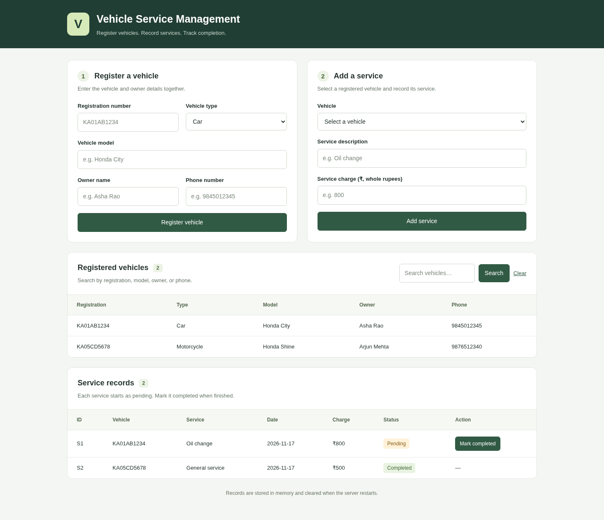
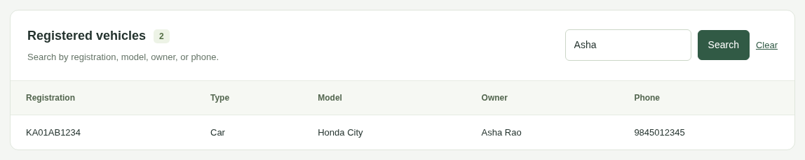
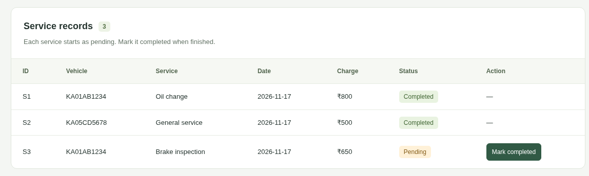
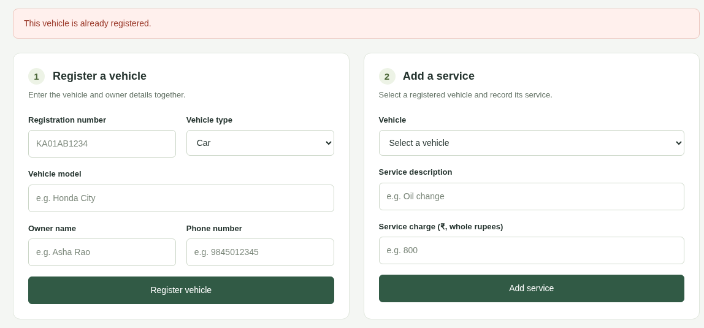

# Vehicle Service Management

A Java OOP mini project for registering vehicles and keeping service records. The browser page has forms for vehicle and owner details, a search box, and a table of services.

## Features

- [x] Register cars and motorcycles with a registration number, model, owner name, and phone number.
- [x] View all registered vehicles and the total vehicle count.
- [x] Search by registration, model, owner, or phone. Searches ignore letter case.
- [x] Clear the search to return to the full vehicle list.
- [x] Reject duplicate registrations, including numbers entered with different spacing or letter case.
- [x] Add a service to a registered vehicle with a description and a charge in whole rupees.
- [x] Assign each service an ID and record the current date automatically.
- [x] Start services as **Pending** and mark them **Completed** when finished.
- [x] Keep previous service records, including multiple services for the same vehicle.
- [x] Check required details and reject invalid charges. Charges must be whole numbers from ₹0 to ₹10,00,000.
- [x] Load two sample vehicles and services with `--demo`.
- [x] Use the page on smaller screens; wide tables scroll horizontally.

## Screenshots

Screenshots from the running application using sample data.

**Main page**



**Search by owner**

Searching for “Asha” shows her vehicle.



**Service records**

The oil change is completed. A second service for the same vehicle is still pending.



**Duplicate registration check**

Entering an existing registration again shows an error.



## Run locally

Requires **JDK 17 or later** and a browser. There are no external libraries to install.

```bash
git clone https://github.com/vlallen544/OOPS_MINI_PROJECT.git
cd OOPS_MINI_PROJECT
./run-ui.sh --demo
```

Open **http://127.0.0.1:8080**. Stop the server with `Ctrl+C`.

Use `./run-ui.sh` for an empty vehicle list. If port 8080 is occupied, use `./run-ui.sh --demo --port=8090`.

Records are stored in `ArrayList` collections. They remain after refreshing the page, but are cleared when the Java server stops. There is no database or login.

## OOP concepts used

| Concept | Where it is used |
| --- | --- |
| Encapsulation | Private fields in `Vehicle` and `ServiceRecord`, accessed through methods. |
| Abstraction | `Vehicle` is abstract and declares `getVehicleType()`. |
| Inheritance | `Car` and `Motorcycle` extend `Vehicle`. |
| Polymorphism | A `List<Vehicle>` holds both types; each returns its own vehicle type. |
| Association | Each `ServiceRecord` refers to a registered `Vehicle`. |

The Java source is in [`src/main/java/com/vehicleservice`](src/main/java/com/vehicleservice). `VehicleServiceManager` handles the operations, `WebServer` receives HTML forms and renders the page, and `Main` starts the application. The UI uses plain HTML and CSS, with no JavaScript.

## Run the test

```bash
mkdir -p out
javac --release 17 -d out $(find src/main/java src/test/java -name '*.java')
java -ea -cp out com.vehicleservice.VehicleServiceManagerTest
```

The test covers registration, searching, duplicate checks, invalid service entries, service history, and completion.

[Presentation notes and viva questions](PRESENTATION.md)
